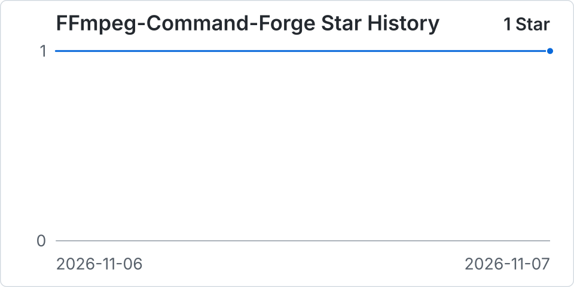

# FFmpeg Command Forge

离线 FFmpeg 命令生成器，预设兼容基线为 **FFmpegFreeUI（3FUI）6.2.43**，采用原生 v6 JSON 格式。界面面向进阶用户，支持参数搜索、滤镜排序、流映射、批量任务和辅助脚本。

## 在线使用

访问 [FFmpeg Command Forge 在线版](https://ffmpeg-command-forge.com/)。网页在浏览器中生成命令，FFmpeg 仍需在本机终端执行。

界面支持简体中文和英文，默认跟随浏览器的语言偏好，未匹配时使用英文。点击右上角的地球图标可手动切换语言。

推送到 `main` 后，“校验与部署 GitHub Pages”运行 Windows、Ubuntu、macOS 完整验证矩阵，包含类型检查、原版参数对照、实际媒体、单文件一致性和 Chromium 离线验收。全部成功后，直接部署本次 Ubuntu 验证上传的 `dist/index.html`。PR 只校验；同分支的新运行会取消过时运行。首次配置或迁移仓库时，在 Settings → Pages 中将 Source 设为 GitHub Actions；也可在 Actions 中手动运行该流程。

## 直接使用

双击根目录的 **FFmpeg Command Forge.html**。该文件已内联全部代码、样式、编码器数据、内置预设和 ZIP 功能；使用时不需要 Node.js、.NET、服务器或网络。执行命令的电脑需要自行安装 FFmpeg，依赖媒体信息时还需要 ffprobe。

1. 导入 3FUI 6.2.43 的预设 JSON（v6），或在“预设库”应用内置预设与 [ffmpeg-full 2026.11.3](https://github.com/Dominic485649/ffmpeg-full/releases/tag/2026.11.3) 的 8 个发行版预设。
2. 在“任务与环境”选择目标系统和终端，粘贴输入路径。工作目录必须是目标系统的绝对路径；也可以直接填写完整输入路径。
3. 设置本次输出目录，或在各输入项中指定输出文件。未指定时沿用预设及命名规则。
4. 按参数分类编辑设置。搜索可以跨分组查找中文字段和常用 FFmpeg 参数。
5. 如果任务需要时长或字幕信息，复制探测命令，执行后导入/粘贴 JSON。也可自行将探测命令的输出重定向保存为文件。
6. 确认字幕、附件、章节、字体和模板路径；跨平台时使用显式路径映射。
7. 待状态显示“命令已就绪”，复制最终脚本到选定终端，或下载脚本/任务包执行。

“命令”视图是候选固定输出路径下的 FFmpeg 命令；**“复制最终脚本”始终包含文件准备、命名冲突处理、全部编码阶段和后处理**。需要辅助操作时应使用完整脚本。

完整脚本在转码前检查整批输出。递增命名会避开已有文件，固定输出默认遇到已有文件就停止。普通单文件任务先在目标目录下转码，再提交成品。若临时授权覆盖，脚本在提交前复核目标是否仍为同一个文件。若提交失败，脚本会报告已编码文件的保留位置。POSIX 目标的无覆盖提交需要目标文件系统支持硬链接，macOS Bash/Zsh 的授权覆盖使用系统 Perl。图片序列、分段和自定义参数产生的额外文件应自行检查。

导出的预设仍是原生 v6 JSON。工作区文件使用 v2 格式，额外包含终端、路径映射及其输入草稿、模板内容和探测缓存，并兼容导入 v1 工作区；不要把工作区文件作为原生预设导入。浏览器缓存只是便利恢复，重要方案请下载保存。

连续编辑会在停止输入 500 ms 后合并保存，持续输入最多等待 2 秒；页面隐藏或离开时尝试补存。界面区分等待保存、已保存和保存失败。多行输入无需失焦即可保存。路径映射不完整时保留原文及错误行号，修正前禁止复制命令、下载脚本和任务包；工作区仍可下载备份。点击诊断可定位到对应字段或输入任务；类型错误的字段保留原始内容，并提供 JSON 修复入口。

批量输入每页显示 50 项，翻页不重建计划，导出始终包含全部任务；诊断会自动切到目标页。新建、替换预设、导入工作区和删除输入支持单步撤销；后续数据编辑或刷新后失效，撤销会关闭覆盖输出授权。

## 终端与平台

| 目标 | 输出 |
| --- | --- |
| Windows | PowerShell 7.3+、Windows PowerShell 5.1、CMD |
| Linux | Bash 3.2+；也可生成 PowerShell 7.3+ 脚本 |
| macOS | Bash 3.2+、Zsh 5.8+；也可生成 PowerShell 7.3+ 脚本 |

PowerShell 5.1 使用原生进程参数字符串，保留空参数与内嵌引号，并并行转发标准输出和错误输出。CMD 的普通命令使用 CMD 引用；完整辅助脚本调用 Windows 自带 PowerShell，下载的 `.cmd` 会关闭延迟展开、切换 UTF-8 代码页并恢复原值。

CMD 交互式复制要求延迟展开关闭（可打开 `cmd /d /v:off`）。内联脚本超长或含 CMD 无法直接传递的参数时，可下载 PowerShell 脚本，或解压整个任务包运行 `forge-task.cmd`。Git Bash 的 Windows 原生进程路径转换不属于目标环境；本机 Git Bash 测试只验证部分 POSIX 引用逻辑。

硬件编码器和外部滤镜仍依赖实际 FFmpeg 构建、驱动、硬件和插件。切换平台不会自动替换编码器。macOS/Linux 首版支持保留修改时间和访问时间；启用创建时间保留时会明确阻断。

## 兼容范围

兼容性验证基于 **FFmpegFreeUI（3FUI）6.2.43**，固定提交 `9cff6bf2d9f8b0162f2e6dc76e539d13a208acf3`。JSON 字段 `预设文件版本 = 6` 表示预设格式版本。

- 186 个顶层预设字段全部具有分组及行为归属，见 [字段清单](docs/FIELDS.md)。
- 保留原始 JSON 和规范化数据，编辑时不删除未知字段。未知版本、枚举及非空未知字段阻止生成可执行脚本。
- 兼容中文字段名、字符串/数字枚举、旧 VBR 数值 3、自定义滤镜迁移和内置滤镜顺序同步。
- 音频使用原版私有 ID；编码器名称与默认附加参数由原版数据库导出。
- 自定义参数按原版 Windows 参数语法解释，支持原版占位符；不把它们当作 Shell 代码执行。
- 不兼容 v5，不提供运行队列、进度控制、Agent、原生插件运行器或硬件监控。

有意差异及验证边界见 [兼容说明](docs/COMPATIBILITY.md) 和 [验证记录](docs/VALIDATION.md)。

## 开发

要求 Node.js 24。构建不依赖原版仓库；测试额外需要 .NET 10 SDK 和 PATH 中的 FFmpeg/ffprobe。Windows 测试还需要 PowerShell 7 和 Git Bash，可通过 `FORGE_PWSH`、`FORGE_BASH` 指定程序路径。

```text
npm ci
npm run check
npm test
npm run build
```

`npm run build` 更新根目录单文件及忽略跟踪的 `dist/index.html`。`npm run preview` 启动本地预览；`npm run test:browser` 使用本机 Edge 检查构建后的 `file:` 页面。

源码按预设、路径/参数、滤镜、流图、编码器、附加输出、执行计划、终端和界面分层。`buildPlan` 不读取 DOM；复制、预览及下载都来自同一份计划。

界面层进一步分为通用控件、字段编辑、工作区状态和持久化；入口连接视图与调度。运行 `node --import tsx tools/benchmark-plan.mjs` 可测量不同名和同名批量任务的执行计划构建耗时，结果不包含转码。运行 `node tools/benchmark-ui.mjs "旧版.html" "FFmpeg Command Forge.html"` 可用本机 Edge 交替测量两个版本的批量界面，每组五次取中位数。

测试工具在 `tools/oracle`：直接编译固定版本的原版纯命令方法，替换的宿主边界仅为程序名、禁用的路径转译及预设克隆。无需编译 LakeUI，也不修改原版仓库。刷新上游资产时运行 `npm run baseline -- <FFmpegFreeUI checkout>`；工具检查固定提交并保存源文件哈希，升级前应先调整基线、检查差异及重新验证。

仓库包含 Windows/Linux/macOS 检查工作流；本地新增工作流不代表已经完成远端运行。

## Star 历史

GitHub Actions 每天更新 `star-history` 分支中的 Star 数量历史。

<p align="center">
  <a href="https://github.com/CialloKing/FFmpeg-Command-Forge/blob/star-history/stars.csv">
    
  </a>
</p>

[查看 CSV 原始数据](https://github.com/CialloKing/FFmpeg-Command-Forge/blob/star-history/stars.csv)。开始每日采集后，CSV 只保留实际采集到的日期。

## 许可

项目采用 MIT 许可。移植的 FFmpegFreeUI 逻辑与数据保留 1059 Studio 的版权和许可；HTML 同时包含 fflate 及相关许可文本。详见 [第三方说明](docs/THIRD-PARTY-NOTICES.md)。
